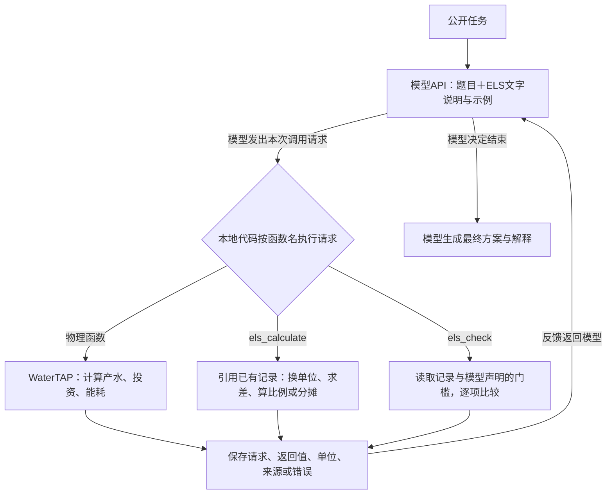

# ELS：方法与代码审阅

## 1. 完整任务如何执行



图中的分支是**当前一次请求的去向**，不是让两个程序同时求解，也不是固定先Tools再ELS。模型可以连续模拟、处理已有结果、检查边界，或根据错误修正调用。尚无记录时无法对该记录计算，其他顺序由模型决定。

本地执行代码只接收、校验和运行请求并保存反馈，不是另一个模型。它不会生成候选、安排整条搜索路径或选择采购答案。WaterTAP的真实计算由宿主传入的`executor(name, arguments)`运行；ELS没有模型API凭据，也不自行启动物理任务。

## 2. IES到ELS增加了什么

IES把专业示范中的准备、比较、核验和停止要求写成文字，由模型执行。ELS进一步提供可以引用计算记录的Python函数，减少模型重新抄数、口算和混用方案数值的机会。

例如，模型先选两种设计并请求WaterTAP计算投资；再调用`difference`读取两条投资记录求差；然后用`ratio`除以模型确定的元件数量，得到美元/支；最后声明报价门槛并请求比较。**比较哪个设计、使用什么数量和门槛、是否批准报价，都由模型决定。**程序不读Gold或rubric，不知道标准答案。

## 3. 接口与证据

构造方式：

```python
runtime = ELS(public_question, adapter, native_schemas, executor, max_calls=20)
```

- `adapter`：每个物理函数的输入规则、返回JSON字段、指标名、单位及币值年份，由宿主提供。
- `native_schemas`：原生工具函数的JSON schema，与适配器的函数名一致。
- `executor`：本地可信回调，签名为`executor(name, arguments)`，返回原始字典或JSON文本。领域错误应返回`{"error": "..."}`，或抛出异常；不能只把HTTP成功当成计算成功。
- `max_calls`：实际物理尝试次数上限；参数校验失败不消耗物理次数，但仍进入调用审计。辅助操作不消耗该物理上限，仍消耗模型预算。总token、请求轮数、超时由宿主限制。

| 记录 | 生成条件 | 保存内容 |
|---|---|---|
| T001… | 进入物理执行回调，包括执行失败 | 参数快照、原始返回、执行状态、返回字段及单位、事件哈希 |
| D001… | 一次辅助运算成功 | 来源记录/指标、运算、数值、单位、声明信息 |
| C001… | 一次边界检查 | 模型声明的约束、每个记录的pass/fail/unknown、来源及当时的证据版本 |

`execute_tool`返回JSON文本供模型读取。`export_trace()`返回包含原始事件、模型反馈、D记录、检查历史、草稿和最终正文状态的快照。宿主必须落盘保存；内存内复制和事件哈希不是外部防篡改存储。

两个函数的调用示例（全部数值仅说明格式）：

```json
{"source":{"record":"T001","metric":"raw_product"},"operation":"convert","target_unit":"m3/day"}
```

```json
{"records":["D001"],"constraints":[{"metric":"value","operator":">=","value":10000,"unit":"m3/day"}]}
```

`convert`只支持已定义的同量纲转换：流量、压力以及完全相同的单位。不能自动把质量流量变成体积流量。金额换币值年份使用模型声明的`scale`倍率及`to_basis`，程序不会验证倍率是否符合题意。

`ratio`可以除以另一条记录，也可以除以模型声明的正数`quantity`及单个非货币单位`quantity_unit`。程序保留该数量的`semantic_verified=false`；不取整，也不替模型确定数量。两种分母形式不能同时使用。

## 4. 是否干预模型判断

**会约束调用格式、单位和证据引用，但不代替工程决策。**格式错误会返回错误；来源缺失、单位不明确或币值不兼容会拒绝运算或返回unknown。这些反馈会影响模型下一步，额外交互也会增加开销，不能宣称完全没有干预。

模型提交正文时，`accept_final`检查是否有成功物理记录、当前证据版本的检查报告，以及该报告是否有unknown。缺失时仅提醒一次；再次结束仍保留正文并标记不完整。它不要求所有候选都通过，也不校验自然语言正文与记录是否一致。

因此可能出现：错误门槛被准确比较；检查通过但正文矛盾；某次检查不通过但模型正确淘汰该候选。这些均应保留并由原rubric解释，不能用`complete`替代评分。

## 5. 如何接入实际模型循环

本PR不修改原`ae.py`执行路径。宿主需要完成以下接线：

1. 将公开任务与`SKILL.md`放入模型上下文，把`runtime.tool_schemas`传给支持函数调用的API。
2. 保存每次原始API请求和返回，调用`runtime.observe_response(raw)`保留正文/草稿；宿主先执行冻结的预算与终止判断，不能把token耗尽草稿当正常最终答复。
3. 对模型返回的每个`tool_call`解析JSON参数，执行`runtime.execute_tool(name, args)`，以对应`tool_call_id`的tool消息返回模型。不得代替模型添加候选或修改门槛。
4. 模型正常停止并输出正文时调用`runtime.accept_final(text)`。若首次抛出`SkillError`提醒，将提醒返回模型；下一次停止仍保留原文。预算不够时保留草稿和终止原因，不自动重跑。
5. 在`finally`中保存原始记录、`runtime.export_trace()`、最终/草稿标记及终止原因。原rubric单独评分。

实际WaterTAP回调可以直接调用本仓库`mcp_watertap/swro_model.py`中的`simulate_swro(**arguments)`；函数工具名`simulate_swro_system`与该函数的对应关系由宿主显式映射。部署需已有WaterTAP和求解器环境。本PR默认示例不会导入或调用它。若使用MCP，宿主还需先解包为领域JSON；运行时不会把MCP内容封装当作物理结果。

## 6. 审阅重点与验证范围

- 模型是否仍控制候选、参数、比较基准、门槛、重试和最终答案？
- D记录能否追溯到真实T记录，是否保留单位和币值，能否防止把重复换算结果当正确证据？
- 错误和unknown是否清楚、可纠正，是否增加了不必要的调用负担？
- 一次提醒、失败草稿、实际物理次数与最终交付状态是否清楚分开？
- 新工具适配能否只补充字段/单位映射，而不加入题目答案或固定搜索？

离线测试检验程序与证据协议，不检验模型收益。合成示例不是benchmark，未启动新模型、Judge或WaterTAP实验。当前SWRO适配不代表已完成D1–D7全量接入。
