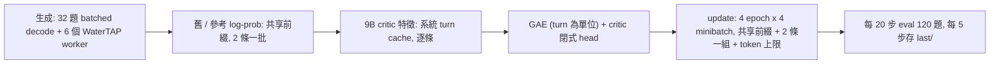

# 08.5：Qwen3.5 PPO 純 MLX 訓練 infra 配方（Apple Silicon 復現手冊）

> 2026-10-22。代碼：`08.5_mlx_stack.py`、`08.5_mlx_stack_ppo_run.sh`、`08.5_mlx_stack_eval_heldout.sh`，輔助腳本和依賴鎖定在 `08.5_mlx_stack_tools/`。
> 實測機器：MacBook Pro M3 Max（40 核 GPU）、64 GB 統一記憶體、macOS 26.7.1。
> 參考 run：`08.5_mlx_stack_runs/ppo-mlx-qwen3.5-9b-l24-n32-lr1e6-err0-delta-s0`（policy Qwen3.5-0.8B + LoRA，critic Qwen3.5-9B 第 24 層；從 07 的 seed 起跑，EXP2 的三項改動：每步 32 題、lr 1e-6、call credit delta，err0 計分）。
> 2026-10-26：第 11 節是 09 的更新（新題庫 train2、小劑量 seed、LR 固定）和兩個修正（resume 時的 LR、SFT 的 MPS 記憶體）；09 的一鍵重現是 `08.5_mlx_stack_tools/run_09.sh`。
>
> 2026-10-28：09 跑完 400 步：held-out 四組平均 0.780 / err0 0.727，和 08.5 @300（0.787 / 0.735）打平，沒有贏過；弱點是從報錯的呼叫恢復（11.4）。

---

## 0. 一頁總結

- **整條 PPO 都在 MLX 上**：生成、舊/參考 log-prob、9B critic 讀特徵、actor 更新，訓練進程裡完全沒有 PyTorch（`--trainer mlx`，`block_torch` 強制）。WaterTAP 工具調用跑在另一個 venv 的 6 個 worker 進程裡。
- **加速和記憶體的關鍵開關**（`PPO_DEFAULTS` 的鍵；run script 以環境變數傳入）：

| 環境變數 | 值 | 作用 | 實測效果 |
|---|---|---|---|
| `PREFIX_SHARE` | 1 | 2560-token 系統前綴每步/每 minibatch 只算一次，episode 只跑 suffix | 梯度更準（對 float32 cosine 0.754 → 0.990）且更快 |
| `UPDATE_MICRO` | 2 | update 時 2 條 episode 一組反傳 | 比 1 條一組快約 10%、梯度更準（0.951 → 0.990） |
| `FORWARD_BATCH` | 2 | 舊/參考 log-prob 前向每批 2 條 suffix | 從 8 改 2 對峰值影響很小，保守取 2 |
| `FAST_RULE` | 1 | gated delta rule 的自訂 VJP scan | 每步 844 → 614 s（1.37×） |
| `FAST_RULE_INV` | 1 | delta rule 裡單位下三角逆矩陣的閉式 VJP | 再快約 2% |
| `UPDATE_MICRO_TOKENS` | 12000 | update 小批次的 token 上限（行數 × 最長 suffix） | update 峰值 ~52 → ~41 GB；長 episode 不再爆記憶體 |
| （預設）`mlx_cache_gb` | 4 | `mx.set_cache_limit(4 GB)` | 防止 MLX buffer cache 膨脹導致 jetsam/重開機 |

- **實測（M3 Max 64 GB，每步 32 題，PPO 4 epoch × 4 minibatch）**：每步約 540–620 s；各階段峰值：生成 ~29 GB、前向 ~20 GB、critic ~22 GB、update ≤ ~42 GB。
- **結果**：dev eval（120 題，err0 計分）0.469 → **0.814**（step 300）；held-out 4 個 probe 平均 step 300 = **0.787**（舊計分）/ **0.735**（err0），之前最好的 07c+D37 @400 是 0.676 / 0.605（配對差 +0.111 [+0.081, +0.140]；第 9 節）。



---

## 1. 硬體與記憶體需求

- Apple Silicon、統一記憶體 **≥ 64 GB**（實測配置）。各階段峰值見上；macOS 自己還要 6–8 GB。
- 記憶體模型（參考 run 55 步擬合，R² 1.00）：**update 峰值 ≈ 12.5 GB + 5.1 GB × (該步最長 suffix 的千 token 數)**（2 條一組時），等價於 **12.5 GB + 2.55 GB / 1k padded token**。`UPDATE_MICRO_TOKENS=B` 把每組的「行數 × 最長 suffix」限制在 B 以內 → 峰值約 12.5 + 2.55 × B/1000 GB。單條超長 episode（suffix ~10k token）單獨算時約 40–43 GB。
- 按機器調整：

| 統一記憶體 | 建議 |
|---|---|
| 64 GB（實測） | 原樣：`UPDATE_MICRO_TOKENS=12000`（約 6% 的長 episode 會單條算） |
| 96 GB | 可把 `UPDATE_MICRO_TOKENS` 提到 ~20000（峰值 ≈ 63 GB），單條算的更少 |
| 128 GB 以上 | 可 `UPDATE_MICRO_TOKENS=0`（不設上限；10k-token 的 pair 約 65 GB）。`UPDATE_MICRO=4` 理論上更快更準，但**未驗證**，要先做梯度對拍 |
| 48 GB | 不建議直接跑 9B critic：生成就要 ~29 GB，update 得壓到 `UPDATE_MICRO_TOKENS≈8000`（約 26% 單條算），最長單條仍可能 ~40 GB |
| ≤ 36 GB | 不可行 |

- 速度隨 GPU 代數/核數變化；M3 Max 的數字見第 9 節。

---

## 2. 取得代碼與資料

```bash
git clone https://github.com/rtong/membraneclaw.git ~/membraneclaw
cd ~/membraneclaw            # 本配方的代碼在 main（合併前用 PR 的分支）
export REPO=~/membraneclaw
export ST=$REPO/experiments/notebooks/smoke_test35
```

git 裡已有：訓練腳本、run script、held-out 腳本、`08.5_mlx_stack_tools/`、資料切分（`06_direction_and_compare_data/`、`07_recover_from_errors_data/`）、seed 的 `adapter_config.json` 和 probe 記錄、基線 07c+D37 的 probe 記錄（`08.5_mlx_stack_runs/ppo-mlx-policy-d37-s0/probes-step*/`）。

**git 沒有、要從舊機器手動拷貝的**（`.gitignore` 排除了 `*_runs/**/*.safetensors`、`adapter*/`、`last/`）：

| 檔案 | 大小 | 必要性 |
|---|---|---|
| `07_recover_from_errors_runs/seed-n200-r100/epoch1/adapter_model.safetensors` | 22 MB | **必須**（起點 seed adapter） |
| `08.5_mlx_stack_runs/<run>/last/`、`adapter-step*/`、`adapter-best/` | ~100 MB + 每個 22 MB | 只有要在新機器上**接著跑**或測某個 checkpoint 時才需要 |

```bash
rsync -av OLD_MAC:<舊 repo>/experiments/notebooks/smoke_test35/07_recover_from_errors_runs/seed-n200-r100/epoch1/adapter_model.safetensors \
  $ST/07_recover_from_errors_runs/seed-n200-r100/epoch1/
```

---

## 3. 環境安裝

用 [uv](https://docs.astral.sh/uv/)（`brew install uv`）。兩個 venv 的路徑是代碼裡寫死的相對路徑，**位置不能改**：

| venv | 路徑 | 用途 |
|---|---|---|
| 訓練 | `$REPO/experiments/membrane_grpo/.venv` | MLX 訓練、生成、probe（run script 用 `../../membrane_grpo/.venv/bin/python`） |
| WaterTAP | `$REPO/.venv-watertap` | 工具 worker（`WATERTAP_PY = REPO/.venv-watertap/bin/python`） |

### 3.1 訓練 venv（Python 3.12）

```bash
cd $REPO/experiments/membrane_grpo
uv venv --python 3.12 .venv
# 最小集合（本配方只需要這些，不需要 torch）
uv pip install --python .venv/bin/python \
  mlx==0.32.3 mlx-metal==0.32.3 mlx-lm==0.31.3 \
  transformers==5.18.0 tokenizers==0.23.2 huggingface-hub==1.33.0 hf-xet==1.6.0 \
  numpy==2.5.3 safetensors==0.8.0 sentencepiece==0.2.2 jinja2==3.1.6 protobuf==7.36.2 \
  psutil==7.2.2 tqdm==4.70.1 pyyaml==6.0.3 regex==2026.9.29
# 完全一致（或最小集合在冒煙測試報缺包時）：
#   uv pip install --python .venv/bin/python -r $ST/08.5_mlx_stack_tools/requirements-train.lock.txt
```

> mlx 版本要釘住：`mlx_inverse_unit_lower` 刻意避開了 MLX 0.32.3 裡 strided slice（`x[..., 0::2]`）反傳出錯的 bug；別的版本行為可能不同。

### 3.2 WaterTAP venv（Python 3.12）+ IDAES 求解器

```bash
cd $REPO
uv venv --python 3.12 .venv-watertap
uv pip install --python .venv-watertap/bin/python -r $ST/08.5_mlx_stack_tools/requirements-watertap.lock.txt
.venv-watertap/bin/idaes get-extensions        # 裝 ipopt 等到 ~/.idaes/bin
~/.idaes/bin/ipopt -v                          # 確認可執行
```

（`mcp_watertap/requirements.txt` 的 conda + reaktoro 環境是部署用的，本實驗**不需要** reaktoro。）

### 3.3 預先下載模型（約 20 GB）

```bash
cd $REPO/experiments/membrane_grpo
.venv/bin/hf download Qwen/Qwen3.5-0.8B      # 1.6 GB，policy
.venv/bin/hf download Qwen/Qwen3.5-9B        # 18 GB，critic（訓練時只 lazy 載入前 24 層）
```

斷網時用本地緩存即可（log 裡的 “Could not reach the Hub … Using cached commit hash” 無害）。

---

## 4. 冒煙測試（約 5 分鐘）

```bash
cd $ST
../../../.venv-watertap/bin/python -c "import watertap, idaes, pyomo; print('watertap ok')"
# 用 seed adapter 跑 4 道 dev 題：驗證模型載入、MLX 生成、WaterTAP worker、計分
../../membrane_grpo/.venv/bin/python 08.5_mlx_stack.py probe --split dev --stop-at-json 1 --temperature 0 \
  --forced 0 --limit 4 --generator mlx --adapter 07_recover_from_errors_runs/seed-n200-r100/epoch1 --out smoke/seed-probe
ls 08.5_mlx_stack_runs/smoke/seed-probe/      # 應有 dev-T0-n4-stop.json 和 .episodes.jsonl
```

---

## 5. 啟動訓練

```bash
$ST/08.5_mlx_stack_tools/launch_9b.sh            # 新 run；印出 run script 的 pid（在前台執行它，它自己會丟到背景）
$ST/08.5_mlx_stack_tools/launch_9b.sh resume     # 從 last/ 接著跑
```

`launch_9b.sh` 的完整配置（任何一項都可用環境變數覆蓋）：

```
CRITIC=qwen3.5-9b CRITIC_LAYER=24 CRITIC_RIDGE=1.0 CRITIC_L2=0.1 ALPHA=0 PROVER_K=4 SEED=0
RUN=ppo-mlx-qwen3.5-9b-l24-n32-lr1e6-err0-delta-s0 WARM_FROM= PROMPTS=32 LR=1e-6
ERR_CALL_CREDIT=0 CALL_CREDIT=delta STEPS=400 STOP_AT=300 GENERATOR=mlx-batch
EVAL_EVERY=20 EVAL_CASES=120 PATIENCE=100 STALL_AT=0 SAVE_EVERY=5 STEP_WATCHDOG=14400
PREFIX_SHARE=1 UPDATE_MICRO=2 FORWARD_BATCH=2 FAST_RULE=1 FAST_RULE_INV=1 UPDATE_MICRO_TOKENS=12000
```

其餘由 run script 的 D37 預設帶入：`adv_norm=minibatch`、`minibatches=4`、`inner_epochs=4`、`max_grad_norm=0.5`、`adam_eps=1e-5`、lr 線性衰減到 0（在 `STEPS=400`，`STOP_AT=300` 停）、KL 0.01、λ 0.95、turn 為 credit 單位、critic warm-up 25 步、`value_init_bias` 從 seed 的 `dev-T1-n120-stop.json` 讀。

> 參考 run 的歷史：`PREFIX_SHARE` 從 step 10、`FORWARD_BATCH=2` 從 70、`FAST_RULE` 從 75、`FAST_RULE_INV` + token 上限從 85 才中途打開（`config-resume-step*.json`）。新機器從 step 0 就全開，數值上不會和參考 run 逐位元一致（另有採樣隨機性），但配方相同。

防止閒置睡眠（插電、開蓋時）：

```bash
caffeinate -dims -w $(pgrep -f "08.5_mlx_stack.py ppo" | head -1) &
```

---

## 6. Infra 組件說明（都在 `08.5_mlx_stack.py`）

### 6.1 純 MLX trainer
- `train_ppo_mlx`：整步在 MLX 上；`block_torch` 讓訓練進程內任何 `import torch` 直接報錯（transformers 只載 tokenizer）。
- Policy：mlx-lm 的 Qwen3.5-0.8B + `LoRALinear`（r 16），`MLXTrainable` 讀寫 PEFT 格式 adapter；LoRA 參數 float32。
- AdamW 開 bias correction（對齊 PyTorch；MLX 預設不開）。

### 6.2 可微的 gated delta rule
- mlx-lm 的 delta rule Metal kernel 沒有 backward；它的訓練路徑逐 token 迴圈並保留每個 token 的 state（5.4k token 的 episode 約 90 GB）。
- `mlx_chunk_gated_delta_rule`：64-token chunk、內部 float32；`mlx_checkpoint_layers` 每層在 backward 重算 forward。推理（生成、critic）仍用 Metal kernel。
- **`FAST_RULE`**（`mlx_chunk_gated_delta_rule_fast` + `_fast_scan`，`mx.custom_function` 自訂 VJP）：只有 state 遞推是順序的（每 chunk 每方向 2 個 matmul），輸出和所有 per-chunk 梯度都批量算；forward 把 chunk state 傳給 backward。
  - 正確性：輸出、最終 state、dq 與原實現**逐位元相同**；其他梯度 float32 下相對誤差 ≤ 1.1e-6；update 梯度對 float32 真值的 cosine 與原實現相同（0.99335）。
  - 速度：rule 的 VJP 2.4–3.5×；整步 844 → 614 s。
- **`FAST_RULE_INV`**（`_fast_inv`）：`M = (I + N)^-1` 的閉式 VJP `dA = tril(-Mᵀ dM Mᵀ, -1)`，forward 不變。輸出逐位元相同，梯度相對誤差 ≤ 1.3e-7；端到端約 +2%（ABBA 計時）。
- 試過沒用的：`mx.compile`（整段 rule 1.07×、每個 decoder layer 0.97–1.02×；瓶頸是前後依賴的小 kernel 數量，不是缺融合）、手寫 Metal kernel（樸素版不比自訂 VJP 快）、選擇性 checkpoint（2 條一組時無加速且 8k token 多 11.5 GB）。

### 6.3 共享前綴（`PREFIX_SHARE`）
- `step_prefix_len` 找出所有 episode 共享的系統前綴（約 2560 token；每條 episode 約 5.5k token）。
- 前向：`mlx_prefix_states` 算一次前綴 state（attention 的 KV、delta 層的 conv/recurrent state），`mlx_suffix_forward` 從 state 跑各條 suffix；`mlx_batch_logprobs_p`（`FORWARD_BATCH` 條一批）。
- update：`mlx_actor_grads_p` —— 每個 minibatch 先算前綴 state，按長度排序後每 `UPDATE_MICRO` 條一組跑 suffix 的 value_and_grad（同時對 LoRA 參數和前綴 state 求導），前綴 state 的 cotangent 用 float32 累加，最後**只對前綴做一次 VJP**。
- 好處不只是快：舊的逐條路徑裡，每條 episode 各自對共享前綴反傳，bf16 捨入讓「advantage 正負相消」後的小梯度嚴重失真（對 float32 cosine 0.754）；共享前綴後在 state 層先相消再反傳（micro 2：0.990，micro 1：0.951）。

### 6.4 update 的 token 上限（`UPDATE_MICRO_TOKENS`）
- MLX 的 backward 是一整張 lazy graph，峰值隨 suffix 長度線性漲（見第 1 節模型）。
- `length_groups(order, lengths, size, max_tokens)`：按長度排序後切組，每組最多 `size` 條，且「行數 × 組內最長」≤ `max_tokens`；超出的長 episode 單獨一組。
- 驗證：上限小到全部單條 == micro 1 逐位元；上限極大 == micro 2 逐位元。
- 實測：設 12000 後 update 峰值最高 41.9 GB；同期一條 10281-token suffix 的 episode 若不設上限估計要 ~65 GB。

### 6.5 生成、critic、工具
- `GENERATOR=mlx-batch`（`rollout_mlx_batched`）：每輪把所有未結束的 episode 一起解碼；eval 每 16 條一批（`eval_batch`）。
- `MLXSeparateCritic`：Qwen3.5-9B 讀第 24/32 層殘差流（每個 turn 前最後一個 token）；系統 turn 的 cache 算一次、每條 episode 複製；只載入到第 24 層（lazy load）；用推理 Metal kernel。特徵進 closed-form ridge head（ridge 1.0、l2 0.1、窗口 25 步）。
- 工具：`ToolPool(6)` 起 6 個 `.venv-watertap` worker（JSON lines），模擬結果有 cache。

### 6.6 記憶體與日誌
- `mlx_cache_gb`（預設 4）→ `mx.set_cache_limit`。**MLX 預設 cache 上限是工作集的 1.5 倍**：兩個大 MLX 進程同時跑時各吃 ~50 GB，曾導致 jetsam → watchdog panic → 整機重開。
- 每步記錄各階段峰值：`mem_gen_gb`、`mem_fwd_gb`、`mem_critic_gb`、`mem_update_gb`，以及 `mem_peak_gb`、`mem_active_gb`、`mem_cache_gb`。

---

## 7. 監控

```bash
cd $ST
R=08.5_mlx_stack_runs/ppo-mlx-qwen3.5-9b-l24-n32-lr1e6-err0-delta-s0
tail -3 $R/run.log                                  # 每步一行摘要 + critic/update 統計
python3 -c "import json; [print(r['step'], r['step_seconds'], r['gen_seconds'], r.get('mem_update_gb'), round(r['reward_mean'],3)) for r in map(json.loads, open('$R/metrics.jsonl'))]" | tail -5
python3 -c "import json; [print(r['step'], round(r['reward'],4), r['decision_correct'], r['evidence']) for r in map(json.loads, open('$R/eval.jsonl'))]"
08.5_mlx_stack_tools/watch_eval.sh $R <run script pid>   # 下一次 eval 寫出（或 run 結束）時印摘要後退出
```

run 目錄：`config.json`、`config-resume-step*.json`（續跑時改了哪些設定）、`metrics.jsonl`、`eval.jsonl`、`samples.jsonl`、`run.log`、`last/`（每 `SAVE_EVERY` 步的完整狀態）、`adapter-step*/`（每次 eval）、`adapter-best/` + `best.json`、`ending.json`（結束時）。

健康指標參考（參考 run，step 75 之後）：approx_kl ≤ 0.007、clip_frac ~0.001、entropy 0.010–0.02、對參考模型 KL ~0.003–0.005、critic value_ev 0.4–0.5。

---

## 8. 運維規則（都是踩過的坑）

1. **一次只跑一個大 MLX 進程。** 另開的測試進程一律 `mx.set_cache_limit(1<<30)` + `mx.set_memory_limit(12<<30)`，開之前看 `memory_pressure | tail -1` 空閒 ≥ 30%。probe（0.8B，cache 2 GB）和訓練並行可以，約 3–5 GB。
2. **絕不編輯正在跑的 run script。** bash 是邊跑邊讀腳本的；一律從凍結副本 `08.5_mlx_stack_ppo_run.live.sh` 啟動（`launch_9b.sh` 會自動 `cp`；它在 `.gitignore` 裡）。
3. **中途改設定只在存檔點做**：等 `last/state_mlx.json` 的 step 到目標（`SAVE_EVERY=5`）→ 殺 run script 和 python → `RESUME=1` 帶新環境變數重啟。用 `08.5_mlx_stack_tools/switch_at_save.sh`；trainer 會寫 `config-resume-stepN.json` 並印 “resumed with changed settings”。
4. **電源**：滿載用電池約每分鐘 −1.5~1.7%。94 W 充電器只勉強夠訓練（實測每小時 0 到 −3%）；訓練 + probe 並行時每小時掉約 6%；140 W 可以邊跑邊充（約每分鐘 +0.6%）。用電池時**合蓋會睡眠**，訓練跟著停（喚醒後自動繼續，不丟進度）。`battery_guard.sh` 在電量 ≤ LOW 時 SIGSTOP 訓練/probe 進程、≥ HIGH 時恢復；殺掉 guard 會先恢復被暫停的進程（在它當前的 `sleep 30` 結束後）。
5. **step watchdog** 會把暫停時間算進去：`STEP_WATCHDOG=14400`（4 小時），短於此的暫停不會被誤殺。
6. **不要把 `launch_9b.sh` 用 `&` 丟到 zsh 背景**：zsh 的 BG_NICE 會讓它和子進程 nice 5，訓練變慢；腳本自己會 `nohup … &`。
7. **選模型看 held-out，不看 adapter-best。** 參考 run 的 dev 貪婪 eval 在 step 120–260 停在 0.78–0.80，「best」一度停在 step 120，但 held-out 同期仍顯著上升（@200 − @120 +0.027，95% CI [+0.006, +0.049]）。最後 dev 的 best = 300，held-out 也是 300 最高（4 probe 平均 0.787 / err0 0.735）。

---

## 9. 實測數據（M3 Max 64 GB）

**速度**（每步 32 題；PPO 4×4 = 16 次 optimizer step）：

| 配置 | 每步 | 非生成部分 / 1k token |
|---|---|---|
| 共享前綴（fb 8、micro 2） | 844 s | 136 s |
| + `FAST_RULE` | 614 s | 95 s |
| + `FAST_RULE_INV` + `UPDATE_MICRO_TOKENS=12000` | 540–620 s | 94 s |

- 每步組成約：生成 50–90 s、舊 log-prob + critic ~130 s、update ~400 s。
- eval（120 題、batched）約 5.5 分鐘；4 個 held-out probe（`--generator mlx` 逐條）單獨跑約 53 分鐘，和訓練並行約 2.6–2.8 小時（期間訓練慢 15–20%）。
- 每步記憶體峰值：生成 28–29 GB、前向 19–20 GB、critic 21–22 GB、update ≤ 42 GB（設上限後）。

**dev eval 軌跡**（120 題，err0 計分；在 step 300 按 `STOP_AT` 停，best = last = 300）：

| step | 0/20 | 40 | 60 | 80 | 100 | 120 | 140 | 160 | 180 | 200 | 220 | 240 | 260 | 280 | 300 |
|---|---|---|---|---|---|---|---|---|---|---|---|---|---|---|---|
| reward | 0.469 | 0.570 | 0.683 | 0.763 | 0.766 | 0.792 | 0.789 | 0.779 | 0.784 | 0.789 | 0.764 | 0.799 | 0.798 | 0.805 | **0.814** |

**held-out 4 個 probe 平均**（test T0、holdout_shift T0、dev 帶失誤開局、dev T1；舊計分 / err0）：

| checkpoint | 舊計分 | err0 |
|---|---|---|
| seed | 0.566 | 0.475 |
| 07c+D37 @300 | 0.676 | 0.605 |
| 07c+D37 @400（之前最好） | 0.676 | 0.605 |
| 本 run @120 | 0.737 | 0.678 |
| 本 run @200 | 0.764 | 0.707 |
| 本 run @240 | 0.770 | 0.712 |
| 本 run @280 | 0.781 | 0.725 |
| **本 run @300** | **0.787** | **0.735** |

配對（同一道題，95% bootstrap 區間）：@300 − 07c+D37 @400 = **+0.111** [+0.081, +0.140]，四個 probe 各自都顯著；@300 − seed = +0.221 [+0.191, +0.251]；@300 − @200 = +0.023 [+0.001, +0.045]；@300 − @280 = +0.007 [−0.011, +0.025]（後段只是緩慢爬升）。

**完全做對的比例**（step 300，err0：被拒絕的調用不算證據）：

| 定義 | test | holdout_shift | dev 帶失誤開局 | dev T1 |
|---|---|---|---|---|
| 決策對且有證據 | 0.800 | 0.625 | 0.771 | 0.650 |
| 答案全對（再加違規項、所有數值、格式） | 0.758 | 0.542 | 0.694 | 0.617 |
| 滿分 1.0（再加調用全對、無多餘模擬） | 0.408 | 0.325 | —（開局失誤不可能滿分） | 0.325 |

07c+D37 @400 的「答案全對」是 0.533 / 0.342 / 0.549 / 0.500；seed 是 0.350 / 0.300 / 0.556 / 0.258。step 300 在 test 上：decision 0.883、evidence 0.825、調用出錯率 0.155。

只有一個 seed；新機器上同配方預期落在同一範圍，不會逐位元相同。

---

## 10. held-out probes 與 err0 重算分

```bash
cd $ST
# 某個已存的 checkpoint，立刻跑 4 個 probe（輸出到 <run>/probes-step120/）
CKPTS="adapter-step120:120" PPO_RUN=ppo-mlx-qwen3.5-9b-l24-n32-lr1e6-err0-delta-s0 ./08.5_mlx_stack_eval_heldout.sh
# 不給 CKPTS：等 ending.json，然後測 best 和最後一個 adapter
# 存檔後自動開跑 + 自動算分：
08.5_mlx_stack_tools/probes_at_step.sh 200
```

probe 存的是舊計分（`err_call_credit 1`）。`rescore_probes.py` 從 `.episodes.jsonl` 離線重算兩種計分，並逐條核對舊計分和存檔一致（參考 run 上 0 差異）：

```bash
../../membrane_grpo/.venv/bin/python 08.5_mlx_stack_tools/rescore_probes.py \
  08.5_mlx_stack_runs/<run>/probes-step200 08.5_mlx_stack_runs/ppo-mlx-policy-d37-s0/probes-step200
```

---

## 11. 09：新題庫、小劑量 seed、LR 固定（2026-10-26）

> 09 沿用本配方的 MLX 訓練 infra（第 6 節的開關全開），改的是資料、seed 和 LR。代碼：`06_direction_and_compare.py`（train2）、
> `08.5_mlx_stack.py`（`seed --ref-split` / `--extra`、resume 時的 LR）、`08.5_mlx_stack_ppo_run.sh`（`SPLIT`）；工具：
> `08.5_mlx_stack_tools/run_09.sh`、`08.5_mlx_stack_tools/09_dose/`。

### 11.1 修正與新開關

- **resume 時的 LR**：resume 會從 `last/opt_mlx.safetensors` 一起恢復存檔當時的 learning rate；`LR_ANNEAL=0`（LR 固定）時沒有人重設它，
  run 會靜靜地用存檔時的 LR 訓（例如 anneal 到一半的 2.7e-7），而 config 寫的是 1e-6。已修：resume 後改用設定的 `lr`
  （anneal 時每個 actor step 本來就會重算，不受影響）。
- **`SPLIT`**（run script）：訓練題檔 `06_direction_and_compare_data/$SPLIT.jsonl`，預設 `train`。trainer 只用它來抽題，檔裡重複的題就是加權。
- **`seed --ref-split S`**：seed 讀 S 的參考 / 恢復 episode（預設 `train`，舊行為不變）。**`seed --extra FILE --extra-split train2`**：
  把一小份指定的 episode（劑量）加進配方的 episode，一起 shuffle。
- **SFT 的 MPS 記憶體**：`seed` 用 PyTorch / MPS；預設上限約 57%（64 GB 機器 36.3 GiB），~330 條的 seed 在第 278 條 OOM。
  SFT 時沒有別的 MLX 進程，用 `PYTORCH_MPS_HIGH_WATERMARK_RATIO=0.85`。

### 11.2 train2：新的訓練題

```bash
cd $ST && ../../../.venv-watertap/bin/python 06_direction_and_compare.py generate --split train2 --workers 12   # M3 Max 578 s
```

- 2400 題、seed 505；level 2 佔 40%（`LEVEL_MIX_BY_SPLIT`；train 是 25%）；每種限制多兩句只給 train2 用的寫法
  （`CONSTRAINTS_TRAIN2_EXTRA`，避開 holdout_shift 的句型，holdout_shift 仍測沒見過的寫法）。`train` 本身的出題完全不變
  （重新出題只差模擬器浮點數的最後一位）。
- `check`：0 重複 prompt；和 train / dev / test / holdout_shift 0 重疊情境；沒有 holdout 句子；0 個 8-gram 和 benchmark 重疊；
  1 題（`swro_check-train2-00484`）和 benchmark 活頁簿用同一個情境，已刪掉，git 裡的 `train2.jsonl` 是 2399 題。
  注意 `check` 會覆寫 git 追蹤的 `06_direction_and_compare_checks.json`（先備份再還原）。
- 帶難換算單位（LMH、LMH/bar、ft²、t/h、MGD、°F）的題：train2 31.4%，train 19.4%。
- `train_all.jsonl` = `train.jsonl` + `train2.jsonl`（3599 題，`run_09.sh` 用 cat 建）。新題只給 PPO 抽題，不拿來大量 SFT。

### 11.3 seed：07 的配方 + 一點點劑量

- 方法（06 / 07）：seed 只給讓行為「活」的最小劑量，學習交給 PPO。大 seed（06 的 1200 條、或 1500 條）一開始分數很高，
  PPO 就帶不動（06：every best checkpoint is step 0）。
- 07 seed 在 T=1 下從沒換對的單位（舊 run warm-up 的 800 個 episode，整題做對數）：t/h 0/52、m³/h 0/11、LMH/bar 1/63、LMH 1/52、
  °F 2/72、kg/h 2/48、ft² 3/70、mg/L 3/49。
- 劑量：每個單位 k 條 train2 的 episode（有恢復 episode 的單位一半用恢復；°F、t/h 沒有，全用參考）。`09_dose/dose09.py` 生成，
  要先有 `reference --split train2` 和 `reference --recover 1 --split train2` 的輸出（各 ~25 分鐘）；git 裡已有 `dose_k{2,4,8}.jsonl`。
- 劑量掃描 k = 2 / 4 / 8，選最小的「活」劑量：每個目標換算在 dev T=1（240 題 × 2）至少做對一次——以換算參數正確計
  （`09_dose/units_args09.py`；k=2：t/h 45/78、m³/h 4/17、LMH/bar 17/151、LMH 35/194、°F 38/168、kg/h 103/220、ft² 70/236、mg/L 31/152），
  另加標準的 `alive`（16/16 答案類別）。整題全對的判準（`09_dose/alive_units09.py`）在這麼低的比率下太嚴也太吵，k = 2 / 4 都沒過；
  k=4 也沒有比 k=2 好（整體 dev T1 0.428 對 0.455），選 k=2。
- `seed-09-k2`：316 條（300 + 16），1 epoch，lr 1e-4，LoRA r16，MPS 約 32 分鐘。held-out（MLX probes，舊計分 / err0）：

| | test | holdout_shift | dev forced | dev T1 | 四組平均 |
|---|---|---|---|---|---|
| 07 seed | 0.564 / 0.489 | 0.516 / 0.447 | 0.688 / 0.545 | 0.496 / 0.419 | 0.566 / 0.475 |
| seed-09-k2 | 0.561 / 0.490 | 0.502 / 0.429 | 0.697 / 0.553 | 0.405 / 0.331 | 0.541 / 0.450 |

### 11.4 PPO

```bash
$ST/08.5_mlx_stack_tools/run_09.sh   # seed -> seed probes -> launch_9b.sh -> caffeinate + probes at 120/200/300/400
```

- `launch_9b.sh` 的設定加上 `SEED_PATH=08.5_mlx_stack_runs/seed-09-k2/epoch1 LR_ANNEAL=0 STEPS=400 STOP_AT=0 SPLIT=train_all`；
  其餘同第 5 節（9B critic 第 24 層、每步 32 題、err0、delta、turn credit、λ 0.95、KL 0.01、4 × 4、grad clip 0.5）。
- 參考 run：`08.5_mlx_stack_runs/ppo-mlx-qwen3.5-9b-l24-n32-lr1e6c-err0-delta-seed09k2-trainall-s0`（2026-10-25 起跑，10-28 跑完 400 步；best = last = 400）。
- dev eval（貪婪，120 題，err0）：0.438（step 0）→ 0.302（40）→ 0.517（60）→ 0.540（80）→ 0.539（100）→ 0.576（120）→ 0.515（140）→ 0.610（160）→ 0.615（180）→ 0.624（200）
  → 0.627（220）→ 0.662（240）→ 0.701（260）→ 0.721（280）→ 0.629（300）→ 0.732（320）→ 0.728（340）→ 0.695（360）→ 0.706（380）→ **0.809（400）**。
  step 40 的掉落是貪婪解碼下第一輪不停寫 `convert_units`（包括同單位換算），寫滿 3072 token 被截斷（0.475）；T=1 抽樣沒有這個現象，step 60 自己恢復。
  140、300、360 的掉落也伴隨同樣的截斷（0.308、0.225、0.150），下一次 eval 回到 0.11 以下。
- held-out（MLX probes，舊計分 / err0，`rescore_probes.py`）：

| | test | holdout_shift | dev forced | dev T1 | 四組平均 |
|---|---|---|---|---|---|
| step 0（seed-09-k2） | 0.561 / 0.490 | 0.502 / 0.429 | 0.697 / 0.553 | 0.405 / 0.331 | 0.541 / 0.450 |
| step 120 | 0.681 / 0.626 | 0.627 / 0.575 | 0.764 / 0.626 | 0.590 / 0.520 | 0.665 / 0.587 |
| step 200 | 0.747 / 0.689 | 0.700 / 0.648 | 0.748 / 0.609 | 0.716 / 0.646 | 0.728 / 0.648 |
| step 280 | 0.760 / 0.728 | 0.691 / 0.653 | 0.749 / 0.607 | 0.713 / 0.664 | 0.728 / 0.663 |
| step 300 | 0.723 / 0.707 | 0.544 / 0.529 | 0.763 / 0.622 | 0.703 / 0.665 | 0.683 / 0.631 |
| step 320 | 0.776 / 0.748 | 0.655 / 0.629 | 0.768 / 0.628 | 0.753 / 0.712 | 0.738 / 0.679 |
| **step 400** | **0.861 / 0.843** | **0.722 / 0.702** | 0.738 / 0.594 | **0.797 / 0.769** | **0.780 / 0.727** |
| 08.5 9B critic @300 | 0.855 / 0.839 | 0.758 / 0.735 | 0.781 / 0.645 | 0.754 / 0.723 | 0.787 / 0.735 |
| 08.5 續跑 @400 | 0.875 / 0.858 | 0.722 / 0.698 | 0.783 / 0.647 | 0.818 / 0.780 | 0.800 / 0.746 |

  「08.5 續跑」：9B critic run 從 step 300 續跑到 400，LR 固定 1e-6，233 題難換算的題加權（`train_units.jsonl`，×3 / ×2；
  `08.5_mlx_stack_runs/ppo-mlx-qwen3.5-9b-l24-n32-lr1e6-err0-delta-s0-from300-const-units`）。四組平均再漲一點，holdout_shift 卻 0.758 → 0.722：
  重複練同一批題。09 因此加新題（train2），不加權重複。
- step 300 的 test / holdout_shift 是貪婪截斷（0.200 / 0.325）拉低的；沒截斷的題 0.904 / 0.805。
- 逐題配對（舊計分，95% bootstrap 區間）：
  - 120 − seed：四組的區間都不含 0（test +0.120、holdout_shift +0.124、dev forced +0.068、dev T1 +0.185）。
  - 400 − seed：test +0.300 [+0.232, +0.368]、holdout_shift +0.220 [+0.153, +0.284]、dev T1 +0.392 [+0.323, +0.463]；dev forced +0.041 [−0.002, +0.088]。
  - 400 − 280：test +0.101 [+0.051, +0.155]、dev T1 +0.085 [+0.035, +0.139]；holdout_shift +0.031 [−0.024, +0.090]、dev forced −0.010 [−0.036, +0.014]。
  - 400 − 320：test +0.085 [+0.027, +0.149]、holdout_shift +0.067 [+0.008, +0.130]、dev T1 +0.045 [+0.000, +0.091]；dev forced −0.030 [−0.053, −0.011]。
  - 400 − 08.5 @300：test +0.006 [−0.042, +0.055]、holdout_shift −0.036 [−0.089, +0.016]、dev T1 +0.043 [−0.014, +0.101]、dev forced −0.043 [−0.088, −0.001]。
- 結論：從較弱的 seed 帶起 +0.238（08.5：0.566 → 0.787，+0.221），**和 08.5 打平，沒有贏過**：四組平均差 −0.008，test / holdout_shift / dev T1
  的區間含 0，dev forced 落後。holdout_shift 到最後沒有退化（400 是 09 的最高點）。09 每題約看 3.6 遍（3599 題），08.5 @300 約 8 遍（1200 題）。
- 弱點是從報錯的呼叫恢復（dev forced：第一個 simulate 呼叫給定為報錯的）。先換單位的路線讓 dev T1 第一個 simulate 呼叫報錯從 52%（step 200）
  降到 18%（step 400；08.5 @300 20%）；dev eval 裡報錯之後恢復的比例跟著從 0.76（step 260）降到 0.40（380）/ 0.53（400），
  dev forced 最高在 step 320（0.768），320 → 400 顯著下降。報錯變少，恢復拿到的訓練訊號也變少。
- 只有一個 seed。held-out probes 是固定步數；best checkpoint 由 dev eval 選出（= 400，最後一步）。

### 11.5 運維補充

- 用 ssh 遠端啟動背景程序：寫成 `cd X; nohup cmd > log 2>&1 < /dev/null &`。不要寫 `cd X && nohup cmd … &`：整串會放進一個子 shell，
  子 shell 的輸出接在 ssh 連線上，連線就一直不結束。
- 時間（M3 Max 64 GB）：warm-up 的 25 步沒有 actor 更新，每步約 3.6 分鐘；之後每步約 10 分鐘；step 120 的 probes 和訓練並行約 3.3 小時；訓練結束後單獨跑約 1 小時（step 400：54 分鐘，step 320：58 分鐘）。

## 附錄：`08.5_mlx_stack_tools/`

| 檔案 | 用途 |
|---|---|
| `launch_9b.sh [resume]` | 以上配置啟動/續跑（凍結副本 + nohup），所有設定可用環境變數覆蓋 |
| `switch_at_save.sh TARGET` | 等存檔到 TARGET 步 → 停 run → 帶新設定 `resume` |
| `watch_eval.sh <run dir> <pid>` | 等下一次 eval（或 run 結束）後印摘要 |
| `battery_guard.sh` | 電量 ≤ LOW 暫停訓練/probe，≥ HIGH 恢復（`LOW=5 HIGH=50 nohup … &`） |
| `probes_at_step.sh N` | 等 `adapter-stepN` 存好就跑 4 個 held-out probe，再算兩種分數 |
| `rescore_probes.py <probe dir>…` | 離線重算舊計分 / err0，並核對存檔 |
| `requirements-train.lock.txt` | 訓練 venv 的完整鎖定（含本配方不需要的 torch/peft/jupyter） |
| `requirements-watertap.lock.txt` | WaterTAP venv 的完整鎖定 |
| `run_09.sh` | 09 的一鍵重現：seed-09-k2 → 它的 held-out probes → PPO（train_all、LR 固定 1e-6、400 步）→ caffeinate + probes |
| `09_dose/dose09.py`、`dose_k{2,4,8}.jsonl` | 09 的劑量（每個從沒換對的單位 k 條 train2 episode）和生成腳本 |
| `09_dose/units_args09.py <label>=<episodes>…` | 每個目標換算的參數正確率（劑量判定用）和整體 reward |
| `09_dose/alive_units09.py <episodes>` | 整題全對的劑量判定（較嚴，k = 2 / 4 都沒過，見 11.3） |
